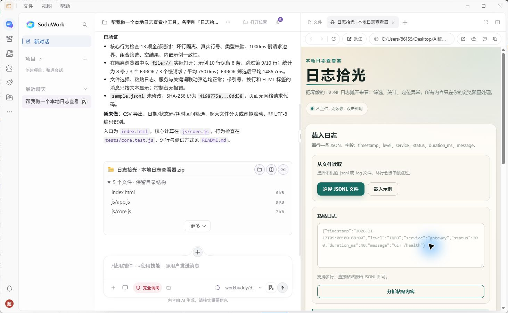
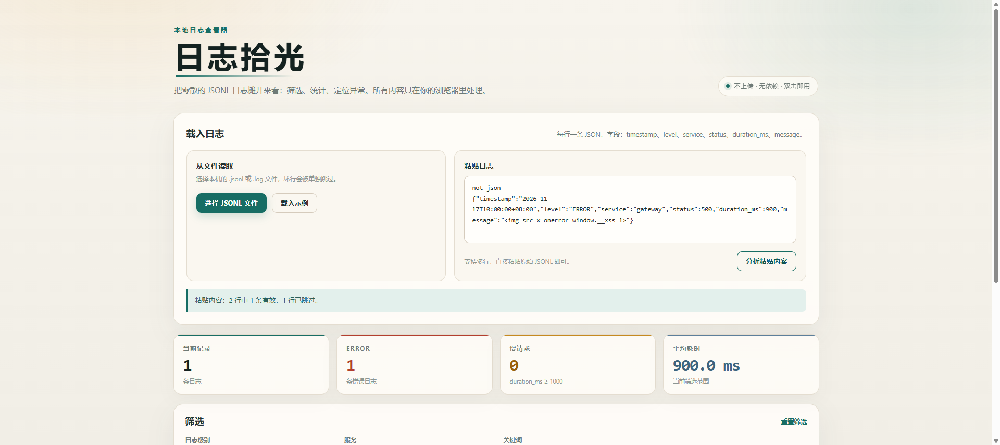

# 我让 Pi 和 OpenCode 接力写了个日志工具，SoduWork 的跨底座开发实测

[SoduWork](https://github.com/mdiri-ai/SoduWork) 有个很实用的切换：Pi 聊到一半，可以把 Agent 换成 OpenCode，接着原来的工作区往下写。平时我写小工具常遇到这种情况：先聊需求、出个能用的版本，后面又想换个 Agent 补功能。真要搬一次目录、解释一遍文件结构，兴致就没了。

这次我拿一个纯前端日志工具做了实测。全程用同一个模型 `workbuddy/deepseek-v4.1-flash`，先让 Pi 写「日志拾光」，再换 OpenCode 加 CSV 导出。最后工具确实能跑，Pi 留下的 13 项测试也没被弄坏，OpenCode 补到了 17 项。

但过程没有宣传词里那么顺：OpenCode 中途卡住了，CSV 代码落盘后，Agent 也没有正常交卷。下面把做成的东西、切换过程和这次失败都放出来。本文的代码与运行记录来自我自己的测试环境，没有额外对比其他模型。

## 先让 Pi 写个能直接用的小工具

我给的需求很普通：不用安装环境，打开 HTML 就能看 JSONL 日志。按级别、服务和关键词筛选，把错误和慢请求标出来，统计条数和平均耗时。页面里附一份样例，方便直接点着看效果。



Pi 在指定的 `app` 文件夹里写了 8 个文件，交付说明列出 13 项测试通过。它的结构挺清爽，HTML、样式和脚本分开，解析与筛选放在 `core.js`，界面事件放在 `app.js`。样例里还放了一行坏 JSON 和一条耗时格式错误的记录，正好检查它会不会把异常数据硬塞进统计。

### 核心模块设计

Pi 写的 `core.js` 是个纯函数模块，不依赖 DOM，浏览器和 Node 都能直接用。开头是字段定义和常量：

```js
var STRING_FIELDS = ['timestamp', 'level', 'service', 'message'];
var NUMBER_FIELDS = ['status', 'duration_ms'];
var SLOW_THRESHOLD_MS = 1000;
```

它把日志记录分成两类字段：四个字符串（时间、级别、服务、消息）和两个数字（状态码、耗时）。慢请求阈值定在 1000ms，后面统计会用。

数据校验函数 `validateRecord` 很严格：

```js
function validateRecord(value) {
  if (!isPlainObject(value)) {
    return { ok: false, reason: '内容不是 JSON 对象（实际为 ' + describeType(value) + '）' };
  }

  for (var i = 0; i < STRING_FIELDS.length; i++) {
    var name = STRING_FIELDS[i];
    var field = value[name];
    if (!Object.prototype.hasOwnProperty.call(value, name)) {
      return { ok: false, reason: name + ' 字段缺失' };
    }
    if (typeof field !== 'string') {
      return {
        ok: false,
        reason: name + ' 应为字符串，实际为 ' + describeType(field)
      };
    }
  }

  for (var j = 0; j < NUMBER_FIELDS.length; j++) {
    var numberName = NUMBER_FIELDS[j];
    var numberValue = value[numberName];
    if (!Object.prototype.hasOwnProperty.call(value, numberName)) {
      return { ok: false, reason: numberName + ' 字段缺失' };
    }
    if (typeof numberValue !== 'number') {
      return {
        ok: false,
        reason: numberName + ' 应为数字，实际为 ' + describeType(numberValue)
      };
    }
    if (!Number.isFinite(numberValue)) {
      return { ok: false, reason: numberName + ' 应为有限数字' };
    }
  }

  return {
    ok: true,
    record: {
      timestamp: value.timestamp,
      level: value.level,
      service: value.service,
      status: value.status,
      duration_ms: value.duration_ms,
      message: value.message
    }
  };
}
```

这个函数做了三层检查：先确认是 JSON 对象，再逐个检查四个字符串字段存在且类型正确，最后检查两个数字字段存在、是数字、且是有限的。任何一项不满足都会返回 `{ ok: false, reason: '具体原因' }`，不会静默吞掉错误数据。

解析入口 `parseJSONL` 逐行处理，遇到坏行会记录行号和原因，但继续处理后续行：

```js
function parseJSONL(text) {
  var lines = String(text).split(/\r?\n/);
  var records = [];
  var errors = [];
  
  lines.forEach(function (line, index) {
    var trimmed = line.trim();
    if (!trimmed) return; // 空行静默跳过
    
    try {
      var parsed = JSON.parse(trimmed);
      var validation = validateRecord(parsed);
      if (validation.ok) {
        records.push(validation.record);
      } else {
        errors.push({ line: index + 1, reason: validation.reason });
      }
    } catch (e) {
      errors.push({ line: index + 1, reason: 'JSON 解析失败: ' + e.message });
    }
  });
  
  return { records: records, errors: errors };
}
```

这个设计很贴心：坏行不会让整个文件崩溃，而是单独列出来。我在样例里故意放了一行 `{"timestamp": "2024-01-15"}`（缺少其他字段）和一行 `{"timestamp": "2024-01-15T10:00:00", "level": "INFO", ... "duration_ms": "not-a-number"}`（耗时是字符串），Pi 都正确识别并跳过了。

### 筛选与统计

筛选逻辑支持三个条件组合：

```js
function filterRecords(records, filters) {
  return records.filter(function (record) {
    if (filters.level && record.level !== filters.level) return false;
    if (filters.service && record.service !== filters.service) return false;
    if (filters.keyword) {
      var keyword = filters.keyword.toLowerCase();
      var inService = record.service.toLowerCase().indexOf(keyword) !== -1;
      var inMessage = record.message.toLowerCase().indexOf(keyword) !== -1;
      if (!inService && !inMessage) return false;
    }
    return true;
  });
}
```

级别和服务是精确匹配，关键词会同时搜索服务名和消息内容（不区分大小写）。统计函数 `computeStats` 会算总数、ERROR 数、慢请求数和平均耗时：

```js
function computeStats(records) {
  var errorCount = 0;
  var slowCount = 0;
  var totalDuration = 0;
  
  records.forEach(function (record) {
    if (record.level === 'ERROR') errorCount++;
    if (record.duration_ms >= SLOW_THRESHOLD_MS) slowCount++;
    totalDuration += record.duration_ms;
  });
  
  return {
    total: records.length,
    errorCount: errorCount,
    slowCount: slowCount,
    avgDuration: records.length > 0 ? totalDuration / records.length : null
  };
}
```


切换界面上可以选 OpenCode，工作区还是 `app`。模型没换，这样不用把后续差异解释成换了个更聪明的模型。

随后我只追加了一条要求：

> 继续完成 CSV 导出。先读取当前代码，在现有筛选结果上加导出，保留原来的功能和测试。

## OpenCode 把功能接上了，交付却断了

OpenCode 没有重做页面，直接在现有按钮区加了「导出当前结果」。`core.js` 里新增 `toCsv(records)`，固定六列：时间、级别、服务、状态码、耗时和消息。这个函数接收的是筛选后的数组，所以导出内容与页面看到的行一致。

### CSV 序列化逻辑

OpenCode 在 `core.js` 里新增的 CSV 处理代码：

```js
var CSV_COLUMNS = ['timestamp', 'level', 'service', 'status', 'duration_ms', 'message'];

function csvCell(value) {
  var text = value === null || typeof value === 'undefined' ? '' : String(value);
  if (/[",\r\n]/.test(text)) {
    return '"' + text.replace(/"/g, '""') + '"';
  }
  return text;
}

function toCsv(records) {
  var rows = [CSV_COLUMNS.join(',')];
  (records || []).forEach(function (record) {
    rows.push(CSV_COLUMNS.map(function (column) {
      return csvCell(record[column]);
    }).join(','));
  });
  return '\uFEFF' + rows.join('\r\n') + '\r\n';
}
```

这里有几个细节值得注意：

1. **转义规则**：`csvCell` 检查文本是否包含逗号、双引号或换行符，如果有就用双引号包起来，内部的双引号翻倍（`"` 变成 `""`）。这是标准的 CSV 转义方式，Excel 能正确识别。

2. **BOM 头**：`toCsv` 返回的字符串以 `\uFEFF` 开头，这是 UTF-8 BOM（字节顺序标记），告诉 Excel 这是 UTF-8 编码，避免中文乱码。

3. **CRLF 行尾**：用 `\r\n` 而不是 `\n`，这也是为了兼容 Excel（Windows 系统默认用 CRLF）。

4. **空值处理**：`csvCell` 把 `null` 和 `undefined` 转成空字符串，避免导出 `null` 或 `undefined` 字样。

### 界面集成

`app.js` 里的导出按钮逻辑：

```js
function exportCsv() {
  if (!state.loaded || state.filtered.length === 0) return;

  var canDownload = typeof window.Blob === 'function' && window.URL &&
    typeof window.URL.createObjectURL === 'function';
  if (!canDownload) {
    els.exportNote.textContent = '当前浏览器不支持直接下载，请换用新版浏览器。';
    return;
  }

  var blob = new window.Blob([core.toCsv(state.filtered)], { type: 'text/csv;charset=utf-8' });
  var url = window.URL.createObjectURL(blob);
  var link = document.createElement('a');
  link.href = url;
  link.download = exportFileName();
  link.style.display = 'none';
  document.body.appendChild(link);
  link.click();
  link.remove();

  window.setTimeout(function () {
    if (typeof window.URL.revokeObjectURL === 'function') {
      window.URL.revokeObjectURL(url);
    }
  }, 1000);

  els.exportNote.textContent = '已导出 ' + state.filtered.length + ' 条记录';
}
```

它先检查是否已加载数据且筛选结果不为空，然后创建 Blob 对象，生成下载链接，触发点击，最后清理。`exportFileName()` 生成带时间戳的文件名，格式是 `日志拾光-20240115-103045.csv`。

按钮状态控制：

```js
els.exportBtn.disabled = !state.loaded || filtered.length === 0;
```

空结果时禁用按钮，避免导出空文件。

我重新跑了测试，17 项全过，其中新增 4 项覆盖 BOM、列序、特殊字符、筛选导出和空结果。接着在 Chrome 里实际点了一遍：样例解析出 8 条有效记录、3 条 ERROR、3 条慢请求，平均耗时 750 ms；筛到 `ERROR + gateway + reset` 后，页面只剩 1 条，下载的 CSV 也只有这 1 条，多行消息仍是一个完整单元格。



## 卡住的过程也得说清楚

第一次切换后，OpenCode 一直读文件、复述计划，没有写完功能。界面显示模型请求失败，但原始日志里的错误是 `Permission channel is unavailable; operation was not approved`，不能把它笼统记成模型不行。

停止、重启后又遇到权限重新确认。我保留原来的会话、工作区和代码，用一句「继续完成上一条 CSV 导出任务」再发了一次。这次代码和测试确实落了盘，但运行记录最终停在 `interrupted`，错误是 `Access session interrupted by Runner restart; confirm permissions to resume`。所以上文的 17 项测试和浏览器验收是我独立做的，不是拿 Agent 的「已完成」当验收。

另外，当前这个聊天使用了 `chat-` 加 UUID 的任务 ID，共 41 个字符；Runner 事件接收端限制为 36 个字符，日志持续出现 `DELIVERY_INVALID`。它会影响运行状态回传，不能据此断言每一步代码失败都是它造成的。我没有改产品源码，只把失败现场、日志和截图保存下来。

这次实测我最喜欢的是切换时不用搬项目：Pi 的文件、OpenCode 的修改和追加测试都在同一个目录里，衔接很自然。需要改进的是中断后的恢复提示，让用户知道去哪重新确认、原会话能否继续，而不是只看到一个转圈或宽泛的模型错误。

如果你也常先搭原型、再补导出或报表，可以试这条接力方式。首版验收留一份，追加需求只写增量，换底座后先读旧测试再动手，会省不少解释成本。本文数据和验证材料在[实测仓库](https://github.com/YJduck123/soduwork-opencode-handoff-eval)。